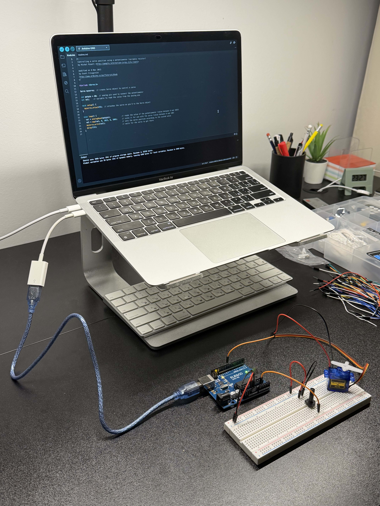

# Potentiometer-Controlled Servo

A simple Arduino project that controls a servo motor using a potentiometer.

## Hardware
- Arduino Uno R3
- Potentiometer
- Servo motor

## Demo
[Watch the project in action](YOUR_VIDEO_LINK)

## Prototype

## Technologies
- C++ (Arduino)
- Embedded Systems
- Analog-to-Digital Conversion (ADC)
- Servo Control
